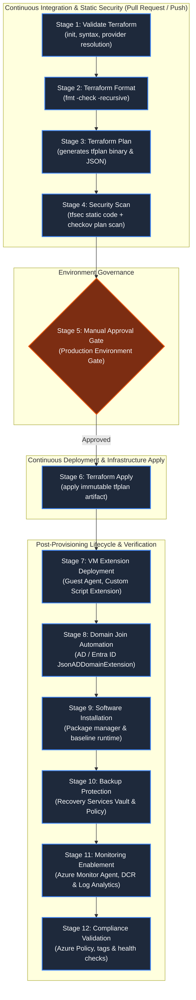

# Enterprise Azure VM Provisioning: 12-Stage CI/CD Pipeline & Modular Terraform Architecture

## Overview & Architecture

This repository contains the enterprise-grade Infrastructure as Code (IaC) framework and 12-stage automated CI/CD pipeline template designed for provisioning, securing, bootstrapping, protecting, and monitoring Azure Virtual Machines.

Both **Azure DevOps Pipelines (`azure-pipelines.yml`)** and **GitHub Actions (`.github/workflows/vm-provisioning.yml`)** implementations are provided, backed by modular Terraform code adhering to cloud landing zone standards and zero-trust security principles.



---

## Directory Structure

```text
.
├── .github/
│   └── workflows/
│       └── vm-provisioning.yml         # GitHub Actions 12-stage workflow
├── azure-pipelines.yml                 # Azure DevOps 12-stage pipeline YAML
├── scripts/
│   ├── bootstrap-windows.ps1           # Windows software bootstrap & hardening
│   └── bootstrap-linux.sh              # Linux software bootstrap & tooling
├── terraform/
│   ├── environments/
│   │   └── prod/
│   │       └── terraform.tfvars        # Environment-specific configuration
│   ├── modules/
│   │   ├── vm/                         # Core compute: NIC, IP, Disk, VM
│   │   │   ├── main.tf
│   │   │   ├── variables.tf
│   │   │   └── outputs.tf
│   │   ├── extensions/                 # Custom Script, Domain Join, AMA
│   │   │   ├── main.tf
│   │   │   ├── variables.tf
│   │   │   └── outputs.tf
│   │   ├── backup/                     # RSV, Backup Policy, Protection
│   │   │   ├── main.tf
│   │   │   ├── variables.tf
│   │   │   └── outputs.tf
│   │   └── monitoring/                 # Log Analytics, DCR, Metrics & Alerts
│   │       ├── main.tf
│   │       ├── variables.tf
│   │       └── outputs.tf
│   ├── main.tf                         # Root composition module
│   ├── variables.tf                    # Root inputs
│   └── outputs.tf                      # Root outputs
└── IMPLEMENTATION_GUIDE.md
```

---

## The 12 Pipeline Stages in Detail

### Stage 1: Validate Terraform (`terraform init`, `terraform validate`)
* **Objective**: Verifies provider schemas, child module contracts, backend storage accessibility, and syntactical validity before executing plans.
* **Mechanism**: Runs `terraform init -backend=true` followed by `terraform validate`. In Azure DevOps and GitHub Actions, the `.terraform` plugin cache is saved to accelerate subsequent steps.

### Stage 2: Terraform Format (`terraform fmt -check`)
* **Objective**: Enforces team-wide HCL code formatting and style consistency.
* **Mechanism**: Executes `terraform fmt -check -recursive -diff`. Fails immediately if any file deviates from canonical HashiCorp conventions.

### Stage 3: Terraform Plan (Generate and Save `tfplan` Artifact)
* **Objective**: Generates a deterministic, immutable execution plan locked to the exact commit and environment tfvars.
* **Mechanism**:
  * Runs `terraform plan -var-file=... -out=tfplan-<id>`.
  * Runs `terraform show -json tfplan-<id> > tfplan.json` to extract a machine-readable plan representation.
  * Publishes both the binary `tfplan` and `tfplan.json` as pipeline build artifacts.

### Stage 4: Security Scan (Static Analysis with `tfsec` & `checkov`)
* **Objective**: Shift-left vulnerability detection and infrastructure misconfiguration detection.
* **Mechanism**:
  * **`tfsec`**: Scans the raw HCL files for high/critical severities (e.g., unencrypted disks, public IPs, open RDP/SSH ports). Outputs SARIF / JUnit test results.
  * **`checkov`**: Evaluates the rendered `tfplan.json` against CIS Azure Benchmarks to inspect calculated attributes and policies before provisioning.

### Stage 5: Manual Approval Gate
* **Objective**: Enforces change management and segregation of duties (SoD) for production deployments.
* **Mechanism**:
  * **Azure DevOps**: Utilizes an `environment: production` deployment job tied to pre-deployment approval checks configured in ADO Service Connections / Environments.
  * **GitHub Actions**: Targets the `environment: production` block configured with Required Reviewers. Non-production runs automatically bypass this gate unless manually forced.

### Stage 6: Terraform Apply
* **Objective**: Deploys cloud infrastructure strictly according to the reviewed, scanned, and approved plan.
* **Mechanism**:
  * Downloads the saved `tfplan` binary artifact from Stage 3.
  * Executes `terraform apply tfplan-<id>` directly. No new plan is generated, guaranteeing zero drift between approval and execution.
  * Captures output variables (`vm_name`, `vm_id`, `nic_id`, `principal_id`) into pipeline variables.

### Stage 7: VM Extension Deployment
* **Objective**: Installs platform agent extensions into the guest OS.
* **Mechanism**:
  * Extensions are declared declaratively in Terraform (`modules/extensions`) with explicit `depends_on` chaining to avoid Windows Guest Agent lock contention.
  * The pipeline executes an active polling check (`az vm extension list`) to verify the provisioning state reaches `Succeeded`.

### Stage 8: Domain Join Automation
* **Objective**: Seamlessly joins the VM to an Active Directory or Entra ID Domain Services domain.
* **Mechanism**:
  * Managed via `JsonADDomainExtension` with domain credentials securely injected via pipeline secret variables into `protected_settings`.
  * The pipeline confirms domain join status via the Azure CLI Guest Agent extension status endpoint.

### Stage 9: Software Installation & Bootstrapping
* **Objective**: Installs foundational software, runtimes, package managers, and base configuration.
* **Mechanism**:
  * Handled via the Azure Custom Script Extension running `scripts/bootstrap-windows.ps1` (or `scripts/bootstrap-linux.sh`).
  * Enforces TLS 1.2, installs Chocolatey / system packages (Git, Azure CLI, Sysinternals, 7-Zip), aligns Azure NTP, and outputs execution records to `C:\WindowsAzure\bootstrap-complete.json`.
  * The pipeline verifies the extension instance status returns exit code 0.

### Stage 10: Backup Enablement
* **Objective**: Protects compute workloads with Azure Recovery Services Vault (RSV).
* **Mechanism**:
  * Creates or binds the VM to an RSV policy (`azurerm_backup_protected_vm`) with daily/weekly retention.
  * The pipeline verifies that the VM item is registered in the backup container and triggers an ad-hoc initial backup job to establish the first recovery point.

### Stage 11: Monitoring Enablement
* **Objective**: Full-stack observability via Azure Monitor Agent (AMA), Data Collection Rules (DCR), and Log Analytics.
* **Mechanism**:
  * Deploys the modern `AzureMonitorWindowsAgent` and `DependencyAgent` extensions.
  * Associates the VM with a Data Collection Rule capturing Windows Event logs, performance counters, and diagnostic settings.
  * Configures Azure Monitor Metric Alerts for High CPU (>90%) and Low Memory (<500MB).
  * The pipeline verifies active DCR associations and diagnostic stream registration.

### Stage 12: Compliance Validation & Health Checks
* **Objective**: Post-deployment verification of cloud governance, platform health, and tagging standards.
* **Mechanism**:
  * **Power State**: Verifies the VM is reporting `VM running`.
  * **Azure Policy**: Queries `az policy state list` to confirm zero non-compliant policy assignments.
  * **Tagging Compliance**: Confirms mandatory enterprise tags (`ManagedBy`, `Environment`, `CostCenter`, `Project`) exist on the provisioned resources.
  * **Azure Advisor**: Checks for operational risk recommendations.
  * Emits an executive deployment summary report.

---

## Authentication & Security Setup

### 1. Workload Identity Federation (OIDC) - No Long-Lived Secrets
Both pipelines utilize OpenID Connect (OIDC) to authenticate against Azure:

#### Azure DevOps
1. Create an Azure Resource Manager Service Connection using **Workload Identity Federation (automatic or manual)**.
2. Grant the Service Principal `Contributor` and `User Access Administrator` (or custom scoped RBAC) on the target Resource Group.
3. Reference the service connection in pipeline YAML:
   ```yaml
   azureSubscription: 'azure-prod'
   ```

#### GitHub Actions
1. In Microsoft Entra ID, create an App Registration.
2. Under **Certificates & secrets** > **Federated credentials**, add credentials for:
   * **Branch**: `repo:<org>/<repo>:ref:refs/heads/main`
   * **Environment**: `repo:<org>/<repo>:environment:production`
3. In GitHub repository **Settings** > **Secrets and variables** > **Actions**, add:
   * `AZURE_CLIENT_ID`
   * `AZURE_TENANT_ID`
   * `AZURE_SUBSCRIPTION_ID`

### 2. Secret Variables (Injected at Runtime)
The following secrets are stored in Azure DevOps Variable Groups (`terraform-secrets`) or GitHub Secrets and passed into Terraform as environment variables (`TF_VAR_<name>`):
* `TF_VAR_admin_password`: Local administrator password.
* `TF_VAR_domain_join_user`: Domain join service account UPN.
* `TF_VAR_domain_join_password`: Domain join service account password.
* `TF_VAR_script_storage_account_key`: Storage account key for retrieving Custom Script bootstrap assets.

---

## Local Development & Validation Runbook

To test and plan locally using your workstation credentials:

```bash
# 1. Login to Azure
az login
az account set --subscription "<YOUR_SUBSCRIPTION_ID>"

# 2. Navigate to terraform directory
cd terraform

# 3. Initialize working directory (backend=false for local syntax verification)
terraform init -backend=false

# 4. Check formatting
terraform fmt -check -recursive

# 5. Validate HCL syntax
terraform validate

# 6. Run plan with dev or prod variables
terraform plan \
  -var-file="environments/prod/terraform.tfvars" \
  -var="admin_password=LocalDevSecretP@ssw0rd!" \
  -var="domain_join_user=sa-join@corp.example.com" \
  -var="domain_join_password=LocalDevSecretP@ssw0rd!"
```

---

## Production Troubleshooting Matrix

| Issue | Typical Cause | Resolution |
| :--- | :--- | :--- |
| **`JsonADDomainExtension` Error code `0x8007052e`** | Bad username or password for domain join account. | Verify `TF_VAR_domain_join_user` and `TF_VAR_domain_join_password` in the pipeline secret store. |
| **`JsonADDomainExtension` Error code `0x80070035`** | Domain controller unreachable (DNS resolution issue). | Confirm the Subnet has custom DNS servers pointed to AD DNS or Azure Private DNS Resolver. |
| **Custom Script Extension hangs / times out** | Script prompt waiting for interactive stdin or network blocked downloading packages. | Ensure all commands in `bootstrap-windows.ps1` use non-interactive flags (`-y`, `-Force`, `--no-progress`). |
| **DCR Association fails with 400 Bad Request** | The VM does not have a System-Assigned Managed Identity enabled. | Ensure `identity { type = "SystemAssigned" }` is enabled in `modules/vm/main.tf` (configured by default). |
| **RSV backup protection 409 Conflict** | Azure Fabric taking time to register compute object after creation. | The backup module includes a 30-minute timeout block to absorb transient registration latencies. |
